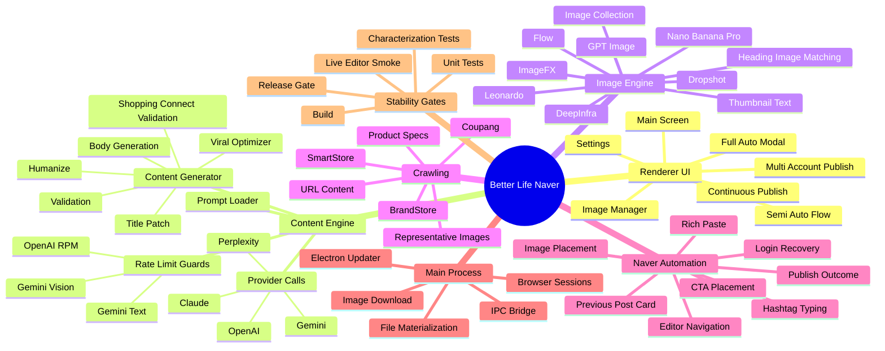

# Better Life Naver App Mind Map

이 문서는 앱의 큰 흐름을 안정화 관점에서 한눈에 보기 위한 지도입니다.  
큰 파일을 줄일 때는 아래 축을 기준으로 하나씩 분리합니다.

## Current Hotspots

| Area | Current risk | Stabilization direction |
| --- | --- | --- |
| `src/renderer/renderer.ts` | UI bootstrap and legacy glue are still large | Keep extracting tab-specific modules and event binders |
| `src/contentGenerator.ts` | Provider calls, validation, prompt orchestration still mixed | Extract validation, rate-limit, cleanup, and provider adapters step by step |
| `src/naverBlogAutomation.ts` | Editor automation has many live selectors | Extract only with characterization tests first |
| `src/main.ts` | IPC and app lifecycle are still concentrated | Move each IPC group to `src/main/ipc/*` |
| image provider files | Browser automation providers can timeout differently | Add queue/time-budget contracts per provider |

## Stabilization Rule

1. Keep public function names compatible.
2. Extract pure logic first.
3. Add characterization tests before moving live browser automation.
4. Run targeted tests, then build, then full tests.
5. Never mix unrelated user changes into a stability patch.
